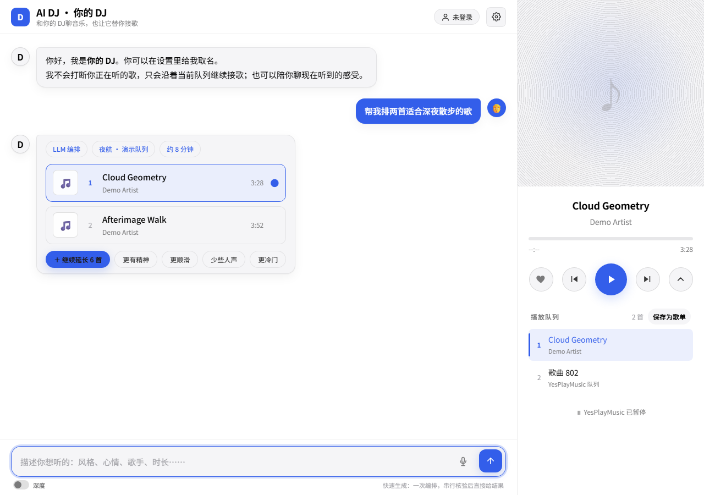
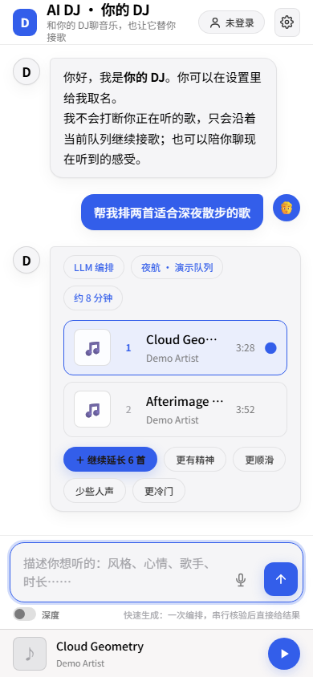

# veasil

工程案例、交互实验与内容工具。

### AI-Native SDLC · 把审阅结果绑定到实际合并的代码

一个以 Slack 为入口、用 Codex 执行任务的交付控制台原型。我想验证的是：当 Agent 写完代码、人工已经审阅、后台任务又可能重启时，系统怎样知道哪一版可以合并、哪些步骤需要继续？

- **任务隔离。** 每个工作项使用独立 Git worktree 和分支。执行器保存提交检查点，测试验证了分支隔离和提交记录。
- **审批绑定版本。** 审批要求对应角色的人工给出理由，产物作者不能批准自己的工作。合并时把审阅通过的提交 SHA 交给 GitHub。若审阅后 PR 又收到新提交，旧审阅不能用来合并新版。
- **重启后恢复。** SQLite 持久化事件和任务交付状态。测试覆盖了数据库重开后的幂等重试、过期任务重新领取，以及两个 worker 争抢同一个在制名额时只放行一个。

**验证范围。** 本地 TypeScript 构建及 117 项测试通过。生命周期集成测试用替身模拟 Codex 和 GitHub 的外部调用，覆盖从任务发起到发布证据触发后续任务。真实 Slack、GitHub 和生产部署的联调仍待验收。源码保留在本机。

### AI DJ · 用对话续接播放队列

基于 [YesPlayMusic](https://github.com/qier222/YesPlayMusic) 的音乐编排实验。AI DJ 负责理解请求、检索候选歌曲和发出队列操作。YesPlayMusic 负责实际播放，并把当前曲目和队列状态同步回对话界面。可以聊正在听的歌、把推荐接到队列末尾，或将队列另存为歌单。

**验证范围。** 本地 3 项 Node 集成测试通过，覆盖使用替身的多轮检索、反馈记录与歌单操作，以及模型设置。浏览器使用模拟播放器宿主与合成曲目，在桌面和手机布局验证了一次追加请求及队列回传。真实网易云音频播放、歌单写入和线上部署仍待验收。

**桌面模拟演示** · 对话推荐与播放器队列并排展示。队列中的「歌曲 802」是模拟宿主同步时的占位名称。

查看手机模拟演示

### 幻觉导航网 · Vibe-Page

一个停在十三年前的虚构中文互联网。访客第一次打开一条路径时生成页面，之后的人会看到同一个版本。

[阅读项目说明](https://github.com/veasil/vibe-page)

### 文章转播客 · Article to Podcast

把文章改写成单人讲解，再合成音频。工具和节目分开维护，可以分别了解制作流程和实际产出。

[查看制作工具](https://github.com/veasil/article-to-podcast) · [浏览节目](https://github.com/veasil/podcast-host)

### 工作坊记录 · FlowHome

一次关于迁居与生活交接的工作坊原型。项目用模拟场景探索物件流转、服务容量与交接成本。

[阅读工作坊记录](https://github.com/veasil/flowhome)
